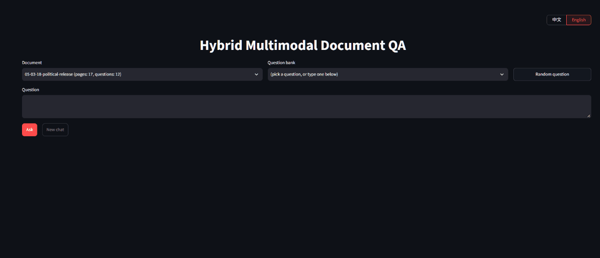
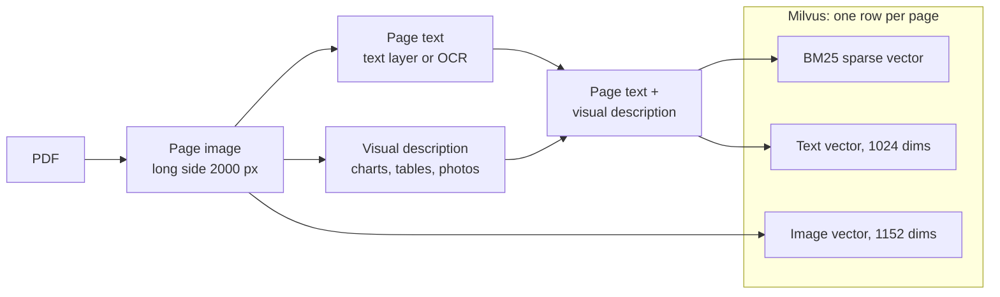
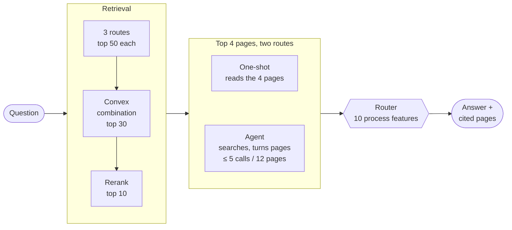

# Hybrid Multimodal Document RAG

<p>
  <a href="./README.md"></a>
  <a href="./README.en.md"></a>
</p>

> Question answering over long PDFs. Every page is indexed both as **text** and as an **image**, and a vision model answers from the page images. Each question runs through two answer routes in parallel, **one-shot answering** and an **agent**, and a lightweight classifier picks one based on how each answer was produced.




*Demo: three questions in a row on Costco's 2021 annual report. Reading a table --> a follow-up completed from the conversation --> EBITDA, which the report never states, found and computed by the agent after searching and turning pages; the router adopts the agent.*

On [MMLongBench-Doc](https://huggingface.co/datasets/yubo2333/MMLongBench-Doc) (snapshot of 2026-09-14: 135 PDFs, 6522 pages, 1082 questions), closed-domain retrieval reaches **r@1 0.581 / r@10 0.897** and answering reaches **Acc 0.677**. Every comparison comes with a paired bootstrap 95% confidence interval.

## Contents

- [Features](#features)
- [How it works](#how-it-works)
- [Models](#models)
- [Results](#results)
- [Design decisions](#design-decisions)
- [Running](#running)
- [Project layout](#project-layout)
- [Data](#data)

## Features

- **Three-way hybrid retrieval**: BM25, text embeddings and image embeddings retrieve separately, a convex combination fuses them, and a cross-encoder reranks.
- **Visual descriptions**: before indexing, a vision model transcribes each page's charts, tables and photos into text appended to the page body. This lifts retrieval coverage of figure evidence by 11.7 points.
- **Answers from page images**: the vision model reads page screenshots directly, so numbers in tables and charts never need to be converted to text first.
- **Two answer routes with routing**: one-shot answering reads the top 4 pages, while the agent can search again and turn pages. A classifier decides which answer to trust based on how each was produced.
- **Visible reasoning**: the UI streams the starting pages, each model call, search queries, viewed pages, the router's choice and both candidate answers.
- **Follow-up questions**: a follow-up is rewritten into a self-contained question using the conversation before retrieval.
- **Chinese / English UI**: switch the language at the top right, or add `?lang=en` to the URL.
- **Built-in evaluation**: retrieval metrics, answer evaluation, per-group breakdowns and paired bootstrap confidence intervals are all in the repository.

## How it works

**Indexing** (offline, one Milvus row per page)



**Answering a question** (online)



**Parsing**: pages with a text layer are extracted block by block in reading order; pages whose text layer is too short or garbled go through PaddleOCR. Page images are scaled to a 2000 px long side, which leaves OCR output unchanged while cutting OCR time and image-embedding cost.

**Visual descriptions**: much of the evidence sits inside charts and figures that body text alone cannot retrieve. A low-cost vision model transcribes each page's charts, tables and photos into text, which is appended to the page body before indexing.

**Retrieval**: each route returns its top 50, scores are min-max normalised per route and summed with weights. The top 30 go to a cross-encoder reranker, which returns the top 10. The weights were chosen by 2-fold cross-validation.

**Answering**: the top 4 page images and the question go to the vision model, which must answer only from those pages. If it cannot, it replies "Not answerable"; it lists the cited pages on its last line.

**Agent**: a hand-written single-agent loop with three tools: semantic search within the document, viewing pages by number, and answering. It is capped at 5 model calls and 12 viewed pages; beyond the caps or on a timeout it is forced to answer from the pages it has seen.

**Routing**: after both routes finish, 10 signals from the answering process go into a logistic regression, for example how often the agent searched, how many pages it viewed and whether either side refused. Above the threshold the agent's answer is used, otherwise the one-shot answer. `train_router.py` fits the weights offline; without a weights file the router falls back to the rule "trust the agent only if it searched".

## Models

All models are served by Alibaba Cloud [Model Studio (Bailian)](https://bailian.console.aliyun.com/).

| Stage | Model | Notes |
|---|---|---|
| Visual descriptions | qwen3.7-flash | Transcribes each page's charts, tables and photos into text |
| Text embedding | qwen3.7-text-embedding | One vector per page over body text plus visual description |
| Image embedding | tongyi-embedding-vision-plus | One vector per page image |
| Reranking | qwen3.7-text-rerank | Reranks the top 30 candidates with a short English task instruction |
| Answering and agent | qwen3.8-flash | Reads page images directly; both routes use a 1024-token thinking budget |
| Follow-up rewriting | qwen3.7-flash | Thinking off, temperature 0, 15 s timeout; falls back to the original question on failure |
| Answer extraction (evaluation) | qwen3.7-plus | Extracts a comparable answer from free text during scoring |

Model names and the thinking budget (`THINKING_BUDGET = 1024`) live in `docrag/config.py`; the model constants for follow-up rewriting and answer extraction sit at the top of their own modules. Swapping a model is a one-line change.

## Results

Full results and per-group analyses are in [docs/results_summary.en.md](docs/results_summary.en.md). \* marks a paired bootstrap 95% confidence interval that excludes 0.

### Retrieval (closed-domain, 845 questions with valid gold pages)

| Route | r@1 | r@10 | MRR | All gold pages in top 4 |
|---|---|---|---|---|
| BM25 | 0.433 | 0.809 | 0.670 | 0.604 |
| Text dense | 0.419 | 0.804 | 0.659 | 0.569 |
| Image dense | 0.258 | 0.695 | 0.477 | 0.408 |
| Three-way convex combination | 0.465 | 0.847 | 0.711 | 0.632 |
| **+ reranking (top 30 candidates)** | **0.581** | **0.897** | **0.826** | **0.731** |

Gain from visual descriptions, on the same reranked route: r@1 0.526 → 0.581 (**+0.055\***), all gold pages in top 4 +0.057\*; for figure evidence 0.601 → **0.718 (+0.117\*)**.

### Answer routes and routing (all 1082 questions)

Same retrieval, same starting 4 pages and same thinking budget, paired question by question; the metric is Acc:

| Route | All (1082) | Single-page (501) | Multi-page (358) | Unanswerable (223) | Per question |
|---|---|---|---|---|---|
| One-shot answering | 0.643 | 0.707 | 0.488 | 0.749 | ¥0.0093 |
| Agent | 0.655 | 0.710 | 0.625 | 0.578 | ¥0.0172 |
| Trust the agent only if it searched (no training) | 0.662\* | 0.715 | 0.572 | 0.691 | ¥0.0265 |
| **Classifier router** | **0.677\*** | 0.709 | 0.618 | 0.700 | ¥0.0265 |

- The classifier router beats one-shot answering by **+0.034\*** (interval [+0.019, +0.050]) and the training-free rule by +0.015\*.
- The two routes differ structurally: the agent is 0.136\* higher on multi-page questions and 0.170\* lower on unanswerable ones. Routing keeps the multi-page gain (0.618) while pulling unanswerable questions back to 0.700.
- Scores are 5-fold cross-validated out-of-fold values with the threshold fixed at 0.5. On the 882 questions not used for prompt selection, the router still beats one-shot answering by **+0.029\***.

### Cost and latency (per question)

Measured on all 1082 questions; generation cost is priced at qwen3.8-flash rates:

| Setup | Cost | p50 / p90 |
|---|---|---|
| One-shot answering | ¥0.0093 | 8.7 s / 15.0 s |
| Agent | ¥0.0172 | 11.1 s / 30.8 s |
| **Both routes in parallel + router** | **¥0.0265** | 11.9 s / 31.2 s |
| One rerank (30 candidates) | ¥0.0096 | — |
| Follow-up rewriting | under ¥0.001 | about 1 s |

With both routes in parallel, latency is that of the slower one; run sequentially, it would be 20.9 s / 42.7 s.

## Design decisions

Each choice rests on a controlled comparison; full numbers are in [docs/results_summary.en.md](docs/results_summary.en.md).

| Decision | Evidence |
|---|---|
| Fuse by convex combination, not RRF | MP-DocVQA, 500 questions, r@1: convex 0.486 > BM25 0.458 > RRF 0.420 |
| Add a cross-encoder reranker | r@1 +0.132\* over the convex combination; top 30 and top 50 candidates tie |
| Keep the image route | With visual descriptions in place, removing it lowers "all gold pages in top 30" by 0.009\* |
| No chunking within a page | Evidence is page-level; chunking splits tables from their captions |
| Answer from 4 pages | 6 pages give +0.015 overall, not significant, and make unanswerable questions worse |
| 1024-token thinking budget | Ties default thinking on 200 questions while p90 drops from 68 s to 15.6 s |
| No LangChain / LlamaIndex | Retrieval, prompts and the agent loop are written from scratch for easier changes and debugging; about 2200 lines in total |
| Pick one of two answer routes per question | The agent alone gives only +0.012; routing gives +0.034\* |
| Record negative results too | Chunking, a different embedding model, structured tables and a larger OCR model were all insignificant or worse |

## Running

You need a [Model Studio (Bailian)](https://bailian.console.aliyun.com/) API key (for embedding, reranking and visual answering) and a local Milvus; OCR on scanned pages also needs paddlepaddle. Put the key in `.env` at the project root: `DASHSCOPE_API_KEY=sk-xxx`.

```bash
pip install -r requirements.txt
docker compose -f milvus/milvus-standalone-docker-compose.yml up -d --wait

# Build the index: each step consumes the previous step's output
python build_dataset.py      # PDF --> page images + pages / queries / qrels / answers
python parse_corpus.py       # text layer where present, OCR for scanned pages --> corpus.jsonl
python describe_pages.py     # visual descriptions, about ¥4.3 for all 6522 pages
python build_index.py        # both embeddings + write to Milvus

# Run the demo
python -m uvicorn demo.app:app --port 8000
python -m streamlit run demo/ui.py

# Run evaluations
python evaluate.py --scope closed --route rerank_convex_bm25_text_image
python evaluate_answers.py --scope closed --route answer_rerank_convex_bm25_text_image
python evaluate_answers.py --scope closed --route agent_rerank_convex_bm25_text_image
python evaluate_answers.py --scope closed --route route_rerank_convex_bm25_text_image

# Retrain the answer router (reads the run files of both answer routes above, overwrites docrag/agent/router_weights.json)
python train_router.py --scope closed
```

To switch datasets, change `DATASET` in `docrag/config.py`; the data directory, Milvus collection and evaluation output directory follow.

## Project layout

```
docrag/
  config.py              dataset registry + constants for every stage
  dataset/               download, page rendering, parsing (text layer / OCR), visual descriptions
  retrieval/             BM25 / dense / convex combination / reranking, one file per route
  generation/            answering, answer extraction and scoring, follow-up rewriting
  agent/                 tools (search / view / answer), agent loop, answer router and its weights
  indexing.py            Milvus schema, indexes, inserts
  embeddings.py          embedding API wrapper: batching, concurrency, rate-limit backoff
  evaluation.py          retrieval metrics (r@k, MRR, full gold coverage)
demo/                    FastAPI backend + Streamlit frontend
evaluations/             evaluation results
```

Code comments are in Chinese.

## Data

- Evaluation dataset: [MMLongBench-Doc](https://huggingface.co/datasets/yubo2333/MMLongBench-Doc); answers are scored with the dataset's own extraction and scoring code (`docrag/generation/mmlongbench_official/`).
  - **Snapshot used here**: downloaded on 2026-09-14, `data/train-00000-of-00001.parquet` at commit `2ff6aa92`, **1082 questions / 135 PDFs / 6522 pages**. Of these, 223 are unanswerable and 845 have valid gold pages for retrieval evaluation.
  - The question count changes as the dataset repository is updated (the Hugging Face viewer showed 1.09k rows at the time of writing). **All scores here come from that snapshot and the dataset's own string-matching scorer, and are not directly comparable with public scores on other snapshots or under other scoring.**
- Dataset used for method selection: [MP-DocVQA](https://huggingface.co/datasets/lmms-lab/MP-DocVQA).
- Embedding, reranking and visual answering use Alibaba Cloud [Model Studio (Bailian)](https://bailian.console.aliyun.com/); vector store [Milvus](https://milvus.io/); OCR [PaddleOCR](https://github.com/PaddlePaddle/PaddleOCR).
