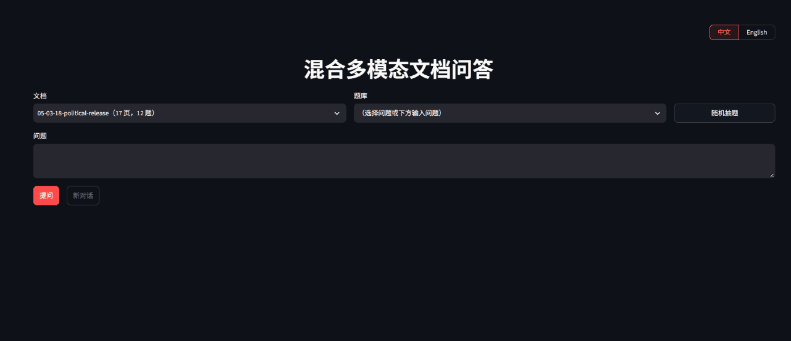
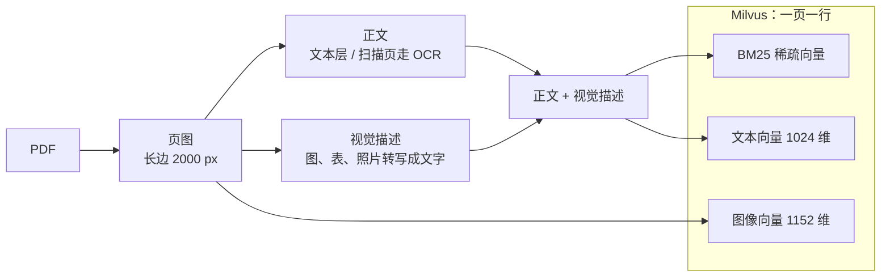
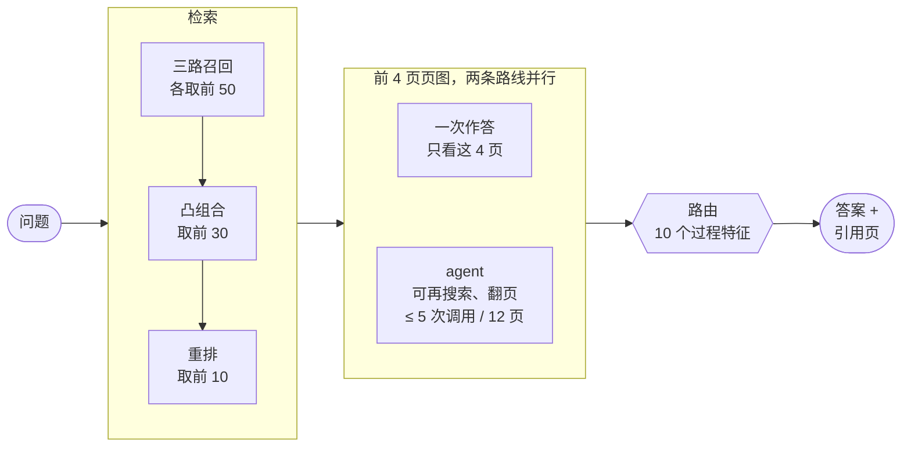

# 混合多模态文档 RAG

<p>
  <a href="./README.md"></a>
  <a href="./README.en.md"></a>
</p>

> 面向长 PDF 的文档问答系统。每一页同时以**文本**和**图像**建立索引，由视觉模型依据页图作答。每道题并行运行**一次作答**和 **agent** 两条路线，再由轻量分类器根据作答过程择一。




*演示：在 Costco 2021 年报上连续提问三轮。读取表格 --> 结合上文补全追问 --> 年报未直接给出的 EBITDA 由 agent 检索、翻页后算出，路由采信 agent。*

在 [MMLongBench-Doc](https://huggingface.co/datasets/yubo2333/MMLongBench-Doc)（2026-09-14 快照：135 份 PDF、6522 页、1082 题）上，闭域检索 **r@1 0.581 / r@10 0.897**，作答 **Acc 0.677**。所有对比均附配对 bootstrap 95% 置信区间。

## 目录

- [功能](#功能)
- [工作原理](#工作原理)
- [模型](#模型)
- [效果](#效果)
- [方法选型](#方法选型)
- [运行](#运行)
- [项目结构](#项目结构)
- [数据](#数据)

## 功能

- **三路混合检索**：BM25、文本向量、图像向量三路召回，凸组合融合后由 cross-encoder 重排。
- **视觉描述增强**：建索引前，视觉模型把每页的图、表、照片转写成文字并入正文。图类证据的检索覆盖率因此提升 11.7 个点。
- **基于页图作答**：视觉模型直接读取页面截图，表格和图中的数字无需先转为文本。
- **双路线作答与路由**：一次作答读取前 4 页，agent 可重新检索和翻页。分类器根据作答过程决定采信哪条路线。
- **过程可见**：界面实时显示检索起点页、模型调用轮次、检索词、查看过的页，以及路由的选择和两条路线各自的回答。
- **多轮追问**：结合上文把追问补全为完整问题后再检索。
- **中英界面**：右上角切换语言，或在地址后加 `?lang=en` 直接打开英文界面。
- **内置评测**：检索指标、作答评测、分组统计和配对 bootstrap 置信区间均在仓库中。

## 工作原理

**建索引**（离线，每页做成 Milvus 里的一行）



**回答一道题**（在线）



**解析**：含文本层的页按块提取并按阅读顺序拼接，文本层过短或乱码的页使用 PaddleOCR。页图长边统一缩放到 2000 px，不影响 OCR 结果，同时降低耗时和图像嵌入成本。

**视觉描述**：大量证据位于图表内，仅凭正文无法检索。低成本视觉模型逐页将图、表、照片转写为文字，并入正文后再建索引。

**检索**：三路各取前 50，分数分别做 min-max 归一后加权相加。前 30 交给 cross-encoder 重排，返回前 10。权重由 2 折交叉验证选定。

**作答**：前 4 页页图与问题一并交给视觉模型，要求仅依据这些页作答。无法作答时输出「Not answerable」，最后一行列出引用页。

**agent**：自实现的单 agent 循环，提供文档内语义检索、按页号查看页图和作答三个工具。最多 5 次模型调用、累计查看 12 页，超出上限或超时则依据已看过的页强制作答。

**路由**：两条路线并行完成后，取 10 个作答过程信号输入逻辑回归，例如检索次数、查看页数、双方是否拒答。输出超过阈值时采信 agent，否则采信一次作答。权重由 `train_router.py` 离线训练；缺少权重文件时，退回「agent 检索过才采信」的规则。

## 模型

以下模型均来自阿里云[通义百炼](https://bailian.console.aliyun.com/)。

| 环节 | 模型 | 说明 |
|---|---|---|
| 视觉描述 | qwen3.7-flash | 逐页把图、表、照片转写为文字 |
| 文本嵌入 | qwen3.7-text-embedding | 正文与视觉描述拼接后整页一条向量 |
| 图像嵌入 | tongyi-embedding-vision-plus | 整页页图一条向量 |
| 重排 | qwen3.7-text-rerank | 附英文任务说明，对前 30 个候选重排 |
| 作答与 agent | qwen3.8-flash | 直接读取页图，两条路线的思考预算均为 1024 token |
| 追问改写 | qwen3.7-flash | 关闭思考、温度 0、超时 15 秒，失败时沿用原问题 |
| 评测抽答案 | qwen3.7-plus | 判分时把自由文本答案抽成可比对的形式 |

模型名与思考预算（`THINKING_BUDGET = 1024`）集中在 `docrag/config.py`，追问改写和评测抽答案的模型常量位于各自模块顶部。更换模型只需修改一行。

## 效果

完整结果与分组分析见 [docs/results_summary.md](docs/results_summary.md)。带 \* 表示配对 bootstrap 95% 置信区间不跨 0。

### 检索（闭域，845 道有有效金标页的题）

| 路线 | r@1 | r@10 | MRR | 前 4 页含全部金标 |
|---|---|---|---|---|
| BM25 | 0.433 | 0.809 | 0.670 | 0.604 |
| 文本 dense | 0.419 | 0.804 | 0.659 | 0.569 |
| 图像 dense | 0.258 | 0.695 | 0.477 | 0.408 |
| 三路凸组合 | 0.465 | 0.847 | 0.711 | 0.632 |
| **+ 重排（前 30 候选）** | **0.581** | **0.897** | **0.826** | **0.731** |

视觉描述带来的提升（同为重排路线）：r@1 0.526 → 0.581（**+0.055\***），前 4 页含全部金标 +0.057\*；其中 Figure 类证据 0.601 → **0.718（+0.117\*）**。

### 作答路线与路由（全量 1082 题）

同一套检索、同样的起点 4 页、同样的思考预算，逐题配对，指标为 Acc：

| 路线 | 全部（1082） | 单页（501） | 跨页（358） | 不可回答（223） | 每题 |
|---|---|---|---|---|---|
| 一次作答 | 0.643 | 0.707 | 0.488 | 0.749 | ¥0.0093 |
| agent | 0.655 | 0.710 | 0.625 | 0.578 | ¥0.0172 |
| 检索过才采信 agent（无需训练） | 0.662\* | 0.715 | 0.572 | 0.691 | ¥0.0265 |
| **分类器路由** | **0.677\*** | 0.709 | 0.618 | 0.700 | ¥0.0265 |

- 分类器路由比一次作答高 **+0.034\***（区间 [+0.019, +0.050]），比无需训练的规则高 +0.015\*。
- 两条路线的强弱是结构性的：agent 在跨页题上高 0.136\*，在不可回答题上低 0.170\*。路由保留了跨页增益（0.618），同时将不可回答题拉回 0.700。
- 指标为五折交叉验证的 out-of-fold 值，阈值固定为 0.5。在未参与提示词选型的 882 题上，路由仍比一次作答高 **+0.029\***。

### 成本与延迟（每题）

全量 1082 题实测，生成侧按 qwen3.8-flash 单价折算：

| 做法 | 花费 | p50 / p90 |
|---|---|---|
| 一次作答 | ¥0.0093 | 8.7 s / 15.0 s |
| agent | ¥0.0172 | 11.1 s / 30.8 s |
| **两条并行 + 路由** | **¥0.0265** | 11.9 s / 31.2 s |
| 重排一次（30 页候选） | ¥0.0096 | — |
| 追问改写 | 不到 ¥0.001 | 约 1 s |

两条路线并行，延迟取较慢的一条；串行则为 20.9 s / 42.7 s。

## 方法选型

每项选择都有对照实验支撑，完整数字见 [docs/results_summary.md](docs/results_summary.md)。

| 决策 | 依据 |
|---|---|
| 融合用凸组合，不用 RRF | MP-DocVQA 500 题 r@1：凸组合 0.486 > BM25 0.458 > RRF 0.420 |
| 加 cross-encoder 重排 | 比凸组合 r@1 +0.132\*；候选取前 30 与前 50 打平 |
| 保留图像路 | 加入视觉描述后移除图像路，前 30 候选含全部金标下降 0.009\* |
| 每页不切块 | 证据以整页为单位，切块会打散表格与图注 |
| 作答给 4 页 | 给 6 页总分 +0.015，不显著，且不可回答题变差 |
| 思考预算 1024 token | 200 题上与默认思考打平，p90 由 68 s 降至 15.6 s |
| 不引入 LangChain / LlamaIndex | 检索、提示词与 agent 循环自行实现，便于修改和排查；全链路约 2200 行 |
| 两条作答路线按题择一 | 单用 agent 总分仅 +0.012，路由后 +0.034\* |
| 负结果同样记录 | 切块、更换嵌入模型、表格结构化、更大的 OCR 模型均不显著或更差 |

## 运行

需要[通义百炼](https://bailian.console.aliyun.com/) API Key（用于嵌入、重排和视觉作答）和本地 Milvus，扫描页 OCR 需安装 paddlepaddle。API Key 写入项目根目录的 `.env`：`DASHSCOPE_API_KEY=sk-xxx`。

```bash
pip install -r requirements.txt
docker compose -f milvus/milvus-standalone-docker-compose.yml up -d --wait

# 建索引：每一步的输入是上一步的输出
python build_dataset.py      # PDF --> 页图 + pages / queries / qrels / answers
python parse_corpus.py       # 文本层直接提取，扫描页走 OCR --> corpus.jsonl
python describe_pages.py     # 视觉描述，全库 6522 页约 ¥4.3
python build_index.py        # 两路嵌入 + 写进 Milvus

# 跑 demo
python -m uvicorn demo.app:app --port 8000
python -m streamlit run demo/ui.py

# 跑评测
python evaluate.py --scope closed --route rerank_convex_bm25_text_image
python evaluate_answers.py --scope closed --route answer_rerank_convex_bm25_text_image
python evaluate_answers.py --scope closed --route agent_rerank_convex_bm25_text_image
python evaluate_answers.py --scope closed --route route_rerank_convex_bm25_text_image

# 重训答案路由（读上面两条作答路线的 run 文件，覆盖 docrag/agent/router_weights.json）
python train_router.py --scope closed
```

更换数据集只需修改 `docrag/config.py` 中的 `DATASET`，数据目录、Milvus 表名和评测结果目录随之切换。

## 项目结构

```
docrag/
  config.py              数据集登记表 + 各阶段常量
  dataset/               下载、渲染页图、解析（文本层 / OCR）、视觉描述
  retrieval/             BM25 / dense / 凸组合 / 重排，一条路线一个文件
  generation/            作答、抽答案与判分、追问改写
  agent/                 工具（搜索 / 看页 / 作答）、agent 循环、答案路由与其权重文件
  indexing.py            Milvus 表结构、索引、写入
  embeddings.py          嵌入接口封装：批量、并发、限流退避
  evaluation.py          检索指标（r@k、MRR、全金标覆盖）
demo/                    FastAPI 后端 + Streamlit 前端
evaluations/             评测结果
```

## 数据

- 评测数据集 [MMLongBench-Doc](https://huggingface.co/datasets/yubo2333/MMLongBench-Doc)，作答判分沿用该数据集自带的抽答案与判分代码（`docrag/generation/mmlongbench_official/`）。
  - **本仓库使用的快照**：2026-09-14 下载，`data/train-00000-of-00001.parquet` 提交 `2ff6aa92`，共 **1082 题 / 135 份 PDF / 6522 页**。其中不可回答题 223 道，可用于检索评测的 845 道。
  - 该数据集的题数随仓库更新而变动（撰写时 Hugging Face 显示 1.09k 行）。**本文分数均基于上述快照和自带的字符串判分代码，不能直接与其他快照或其他判分方式下的公开分数比较。**
- 方法选型阶段的对照数据集 [MP-DocVQA](https://huggingface.co/datasets/lmms-lab/MP-DocVQA)。
- 嵌入、重排、视觉作答使用阿里云[通义百炼](https://bailian.console.aliyun.com/)；向量库 [Milvus](https://milvus.io/)；OCR 使用 [PaddleOCR](https://github.com/PaddlePaddle/PaddleOCR)。
